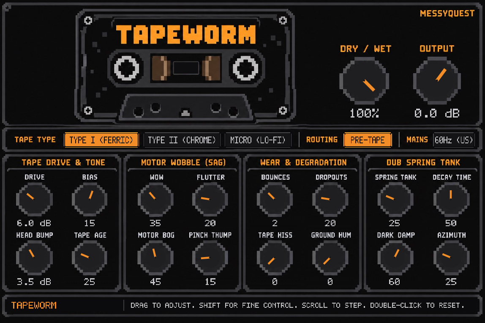

# TAPEWORM

A cassette-tape degradation and lo-fi effect for Linux, in **CLAP** and **VST3** formats.



TAPEWORM imitates cheap, worn cassette gear rather than pristine studio tape: saturation, head bump,
wow and flutter, a motor that bogs down under heavy material, pinch-roller bumps, azimuth wander,
multi-generation dubbing, dropouts, hiss, mains hum and a dub spring tank. It was made for dungeon
synth, dark ambient, lo-fi electronic and retro synthesizer music, and works on anything that should
sound like it lived on a tape for a few decades.

Version 0.1.0 · Linux x86_64 · Licence GPL-3.0-or-later

Website: <https://tapeworm.messy.quest> · Source and issues: <https://github.com/jasonpersinger/TAPEWORM> ·
Contact: info@messy.quest

## Features

| Section | Controls |
|---|---|
| Tape | Tape Type (Type I Ferric, Type II Chrome, Micro / dictaphone), Drive (0 to +24 dB), Bias (−100 to +100), Head Bump (0 to 9 dB), Tape Age |
| Motor | Wow Depth, Flutter Depth, Motor Bog, Pinch Bump, Azimuth Skew |
| Wear | Generations (1–4 dub passes), Dropouts, Tape Hiss, Ground Hum, Hum Frequency (50 / 60 Hz) |
| Spring | Spring Level, Spring Decay, Spring Damping, Spring Routing (Pre-Tape / Post-Tape) |
| Master | Dry / Wet, Output Gain |

All 21 controls can be automated. The editor is a fixed-size pixel-art cassette deck.

## Requirements

* Linux on x86_64 with **glibc 2.35 or newer**. Tested with REAPER on CachyOS and in Debian 12 and
  Ubuntu 24.04 LTS; loading and audio processing also checked on Ubuntu 22.04 LTS.
* A CLAP or VST3 host. Tested with REAPER 7.83.
* An X11 or XWayland session with OpenGL (`libGL`), `libX11`, `libX11-xcb` and `libxcb` — present on
  every normal desktop installation.

## Installation

Download `tapeworm-v0.1.0-linux-x86_64-clap.tar.gz` and/or `…-vst3.tar.gz`, then:

```sh
tar -xzf tapeworm-v0.1.0-linux-x86_64-clap.tar.gz
mkdir -p ~/.clap && cp tapeworm-v0.1.0-linux-x86_64-clap/tapeworm.clap ~/.clap/

tar -xzf tapeworm-v0.1.0-linux-x86_64-vst3.tar.gz
mkdir -p ~/.vst3 && cp -r tapeworm-v0.1.0-linux-x86_64-vst3/tapeworm.vst3 ~/.vst3/
```

Rescan plug-ins in your host (REAPER: *Options → Preferences → Plug-ins → CLAP / VST → Re-scan*). No root
access is needed. Details, verification and uninstalling: [INSTALLING.md](INSTALLING.md).

## Basic use

Put TAPEWORM on a track or bus. The defaults are a moderate "old cassette" setting. Turn up **Drive**
for saturation, **Wow / Flutter / Motor Bog** for pitch instability, **Generations** and **Tape Age** for
a duller, more worn copy, and **Dropouts / Hiss / Hum** for damage and noise. **Spring Routing → Pre-Tape**
sends the reverb through the tape, so its tail gets saturated and wobbles with the transport.

## Things worth knowing

* **Latency:** 15 ms, reported to the host (662 samples at 44.1 kHz, 720 at 48 kHz, 1440 at 96 kHz,
  2880 at 192 kHz), so hosts with delay compensation keep tracks aligned. The internal Dry / Wet path is
  delay-matched.
* **Sample rates:** tested at 44.1, 48, 88.2, 96 and 192 kHz. Rates above 192 kHz are not supported.
* **Saturation is not oversampled.** Bright material driven hard (high frequencies at +12 dB Drive and
  above, especially on Type II) produces audible aliasing. For tones up to about 5 kHz at up to +12 dB Drive,
  aliases stay around −60 dB or lower.
* **Bias** changes the shape of the saturation curve symmetrically: it adds odd harmonics, not the even
  (second-order) harmonics of real tape bias. **Negative Bias combined with high Drive folds the waveform
  back on itself**, which gives a harsh, buzzy, much louder-sounding distortion and lowers the level of
  the original tone. Use it as an effect; leave Bias at or above 0 for conventional tape saturation.
* **Azimuth Skew** moves the left and right channels slightly apart in time (up to about ±91 µs per
  channel), slowly wandering. Summed to mono, this causes comb filtering: at 100 % the first notch can
  reach about 2.8 kHz; at the default 25 % it stays above about 11 kHz.
* **Randomness:** flutter jitter, dropouts and hiss come from pseudo-random generators. A freshly loaded
  instance always starts from the same sequence, but the generators keep running, so two renders in the
  same session are generally not sample-identical.
* **Generations** changes crossfade over about 25 ms and are click-free.

## Building from source

```sh
cargo xtask bundle tapeworm --release
```

produces `target/bundled/tapeworm.clap` and `target/bundled/tapeworm.vst3`. Official release binaries are
built in a pinned Debian 12 environment so they run on older distributions; see
[BUILDING.md](BUILDING.md).

## Contributing

Bug reports and pull requests are welcome at
<https://github.com/jasonpersinger/TAPEWORM/issues>. See [CONTRIBUTING.md](CONTRIBUTING.md), in particular the
rules for changes that affect the sound.

## Licence

TAPEWORM is free software, licensed under the **GNU General Public License, version 3 or (at your option)
any later version**. You may use it for any purpose, including commercial music production, and you may
share, modify and redistribute it under the GPL's terms. See [LICENSING.md](LICENSING.md) for what that
means in practice, [LICENSE](LICENSE) for the licence text and
[THIRD_PARTY_NOTICES.md](THIRD_PARTY_NOTICES.md) for the components TAPEWORM includes.

VST is a registered trademark of Steinberg Media Technologies GmbH. CLAP is an open plug-in standard by
Bitwig and u-he. TAPEWORM is not affiliated with either.
